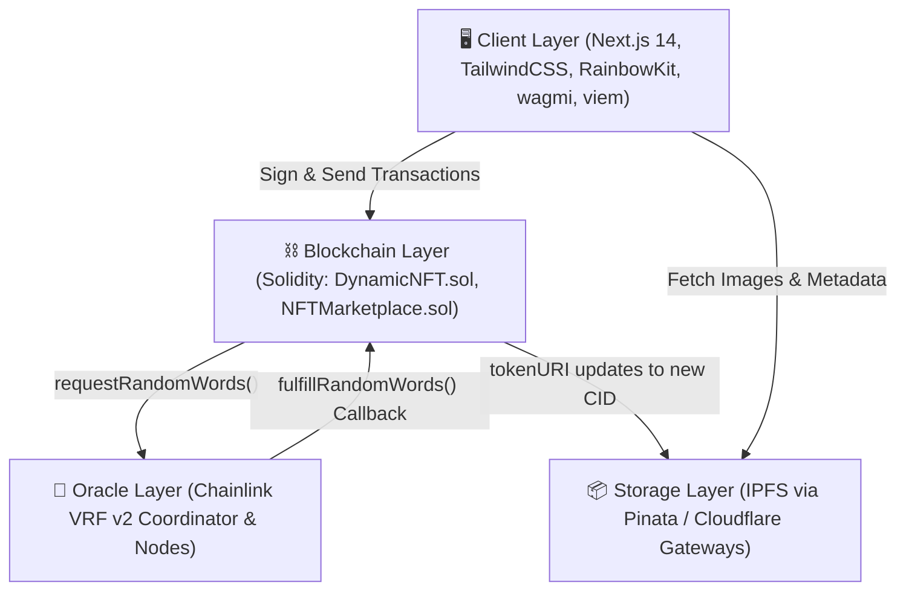

# ⚔️ Warrior of Light: Dynamic NFT & Verifiable GameFi Marketplace (dNFT)

> **ĐỒ ÁN MÔN HỌC CÔNG NGHỆ BLOCKCHAIN**  
> **Khoa Công Nghệ Thông Tin — Trường Đại Học Điện Lực (EPU)**  
> **Sinh viên thực hiện:** Nguyễn Văn Anh Đức  
> **Mã sinh viên:** 23810310118  
> **Đề tài:** Nghiên cứu và Phát triển Hệ sinh thái Token không thể thay thế có thuộc tính động (Dynamic NFT - dNFT) tích hợp Chainlink VRF v2 và Sàn giao dịch phi tập trung On-Chain (Marketplace).

---

## 🌟 Giới thiệu tổng quan

Hệ thống **Dynamic NFT (dNFT)** mô phỏng tiến trình tiến hóa của nhân vật chiến binh ánh sáng (**Warrior of Light**). Khác với các NFT tĩnh truyền thống (Static NFT) với metadata và hình ảnh cố định sau khi mint, dự án này triển khai một mô hình toàn diện đưa toàn bộ logic game, thuộc tính nhân vật và cơ chế thị trường lên chuỗi khối:

1. **Thuộc tính On-Chain thay đổi động**: Cấp độ (`level`), Điểm kinh nghiệm (`exp`), Tấn công (`attack`), Phòng thủ (`defense`), Tốc độ (`speed`).
2. **Cơ chế Rèn luyện (Training)**: Mỗi lần rèn luyện ghi nhận giao dịch On-Chain tích lũy **+25 EXP**.
3. **Tiến hóa qua Chainlink VRF v2**: Khi đạt ngưỡng EXP (100 EXP cho Cấp 2, 300 EXP cho Cấp 3), chủ sở hữu kích hoạt tiến hóa. Hợp đồng gửi yêu cầu tới **Chainlink VRF Coordinator** để nhận số ngẫu nhiên mật mã 256-bit không thể bị thao túng bởi miner/validator.
4. **Cập nhật Metadata & Hình ảnh tự động trên IPFS**: Hợp đồng tự động cập nhật `tokenURI` trỏ sang mã CID mới trên mạng lưu trữ phân tán IPFS (Novice → Elite Knight → Legendary Champion).
5. **Sàn giao dịch phi tập trung (Marketplace)**: Cho phép niêm yết, hủy niêm yết, cập nhật giá và mua dNFT trực tiếp bằng ETH với cơ chế bảo vệ chống tấn công tái nhập (`ReentrancyGuard`) và tự động trích 1% phí sàn.
6. **Bảng xếp hạng chiến lực (Leaderboard)**: Tính toán điểm sức mạnh chiến đấu $CP = ATK \times 1.5 + DEF \times 1.2 + SPD \times 1.0$ theo thời gian thực.
7. **Sổ cái On-Chain thời gian thực (Activity Explorer)**: Truy vấn trực tiếp các Event logs (`Minted`, `LevelUpRequested`, `LevelUpFulfilled`, `ItemListed`, `ItemBought`) từ Smart Contract.

---

## 🏗️ Kiến trúc hệ thống 4 tầng



---

## 📁 Cấu trúc thư mục dự án

```
project/
├── contracts/
│   ├── DynamicNFT.sol                   # Smart Contract dNFT chính (ERC-721, VRFConsumerBaseV2)
│   ├── NFTMarketplace.sol               # Sàn giao dịch phi tập trung (ReentrancyGuard, Non-custodial)
│   └── mocks/
│       └── VRFCoordinatorV2Mock.sol     # Mock Chainlink VRF Coordinator cho môi trường local
├── test/
│   ├── DynamicNFT.test.ts               # 12 Unit Tests kiểm thử dNFT (100% pass)
│   └── NFTMarketplace.test.ts           # 11 Unit Tests kiểm thử Marketplace (100% pass)
├── scripts/
│   ├── deploy-local.ts                  # Triển khai hệ thống contracts lên Localhost & seed data
│   ├── deploy-sepolia.ts                # Triển khai lên mạng thử nghiệm Ethereum Sepolia
│   ├── vrf-listener.ts                  # Background Daemon giả lập phản hồi Chainlink Oracle
│   ├── fund-user.ts                     # Tự động nạp ETH vào ví MetaMask người dùng
│   └── export-frontend-contracts.js     # Tự động đồng bộ ABI và địa chỉ sang Frontend
├── metadata/
│   ├── images/                          # Ảnh đồ họa 3 cấp độ (Novice, Elite, Legendary)
│   └── json/                            # Tệp Metadata JSON chuẩn ERC-721 / OpenSea
├── docs/
│   └── BaoCao_MonHoc_Blockchain_NguyenVanAnhDuc_23810310118.docx # Báo cáo đồ án chính thức
├── frontend/                            # Web DApp Next.js 14 App Router
│   ├── src/
│   │   ├── app/                         # Layout, Page, Providers, Dark Slate Fintech styling
│   │   ├── components/                  # InventoryView, MarketplaceView, LeaderboardView, ActivityView, ThesisDocsView...
│   │   ├── hooks/                       # useNFTContract, useMarketplace, useNFTStats, useBlockchainActivity
│   │   ├── lib/                         # wagmiConfig, contracts, constants, utils
│   │   └── types/                       # TypeScript interfaces
│   └── public/images/                   # Assets ảnh fallback
├── start-all.bat                        # Script khởi động tự động 1-Click toàn bộ hệ sinh thái
├── package.json                         # Dependencies & Scripts Hardhat
└── hardhat.config.ts                    # Cấu hình Hardhat (EVM Cancun, Solidity 0.8.24)
```

---

## ⚡ Khởi động nhanh (Quick Start)

### Cách 1: Khởi động tự động 1-Click (Khuyên dùng trên Windows)
Chỉ cần nhấp đúp chuột vào tệp:
```bash
start-all.bat
```
Hệ thống sẽ tự động khởi động:
1. Hardhat Blockchain Node (Port 8545)
2. Deploy Smart Contracts & Seed dữ liệu mẫu ban đầu
3. Tự động nạp **1,000 ETH** vào ví MetaMask của bạn
4. Chạy Chainlink VRF Daemon
5. Khởi động Web DApp Next.js và tự động mở trình duyệt `http://localhost:3000`

---

### Cách 2: Chạy thủ công từng bước

#### 1. Cài đặt thư viện
```bash
# Cài đặt dependencies cho Smart Contract & Hardhat
npm install

# Cài đặt dependencies cho Frontend
cd frontend
npm install
cd ..
```

#### 2. Chạy kiểm thử tự động (Unit Tests)
```bash
npx hardhat test
```
*Kết quả:* **23 tests passing (100%)**

#### 3. Chạy Blockchain Node & Deploy
```bash
# Terminal 1: Chạy node cục bộ
npx hardhat node

# Terminal 2: Deploy và nạp ETH
npm run deploy:local
npx hardhat run scripts/fund-user.ts --network localhost

# Terminal 2 (tiếp tục): Chạy VRF Listener
npx hardhat run scripts/vrf-listener.ts --network localhost
```

#### 4. Chạy Web DApp
```bash
# Terminal 3: Chạy giao diện
npm --prefix frontend run dev
```
Truy cập [http://localhost:3000](http://localhost:3000) trên trình duyệt.

---

## 📊 Phân hệ giao diện 5-Tab Workspace

1. **Kho Đồ & Tiến Hóa (Inventory & Evolution Deck)**: Quản lý NFT, thanh chỉ số ATK/DEF/SPD, nút Đúc dNFT mới, Rèn luyện (+25 EXP), Kích hoạt tiến hóa VRF, Chuyển ví (Transfer) và Đăng bán sàn.
2. **Chợ Giao Dịch dNFT (Decentralized Marketplace)**: Mua bán trực tiếp bằng ETH theo giá niêm yết, tự động trích 1% phí sàn phi tập trung.
3. **Bảng Xếp Hạng (Leaderboard)**: Xếp hạng người chơi và chiến binh theo điểm chiến lực $CP$.
4. **Sổ Cái On-Chain (Blockchain Event Explorer)**: Tra cứu lịch sử block, transaction hash và sự kiện thời gian thực.
5. **Thẩm Định Bằng Chứng VRF & Đồ Án (Thesis Docs)**: Bảng chứng minh tính ngẫu nhiên mật mã (VRF Seed, Proof, Request ID), sơ đồ kiến trúc và danh mục kiểm toán bảo mật.

---

## 📜 Bản quyền & Giấy phép
Dự án được xây dựng phục vụ học tập và nghiên cứu tại **Trường Đại Học Điện Lực (EPU)** theo giấy phép [MIT License](LICENSE).
